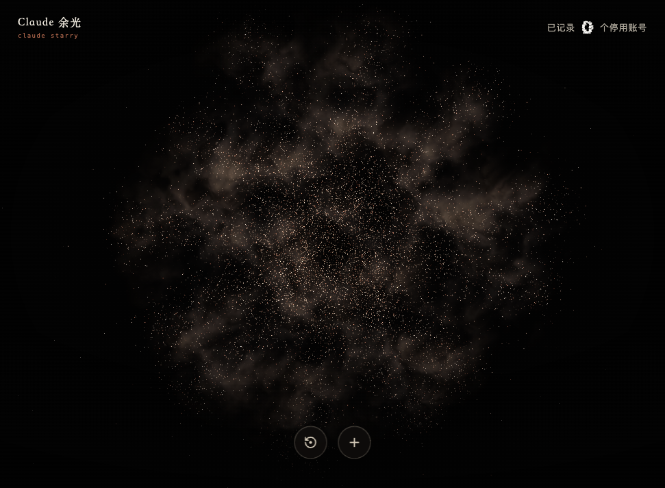

# Claude 余光 · Claude Starry

你的 Claude 账号没有消失，只是从此不再回应，化作了星河里的一点光。

[在线体验](https://claudestarry.pages.dev/) · [GitHub](https://github.com/wavever/claudestarry) · [X @HtWavever](https://x.com/HtWavever) · [部署说明](docs/deployment.md) · [MIT License](LICENSE)

一个由 Claude 用户自发创建的非官方娱乐项目。用 Three.js 绘制星河，
让用户为停用的账号留下一颗星，以及一段可选的故事。



## 功能

- 粒子文字开场、星云、旋转和连续缩放。
- 新记录以流星划入星河；通过 Supabase 同步给在线访客。
- 星星名片、图片复制与下载、由用户操作的 X 分享入口。
- 昵称和停用日期必填，注册日期和故事可留空。
- 中文 / English 界面切换：首次按浏览器语言选择，手动选择会保存在当前浏览器；`?locale=zh-CN` 或 `?locale=en` 可临时指定语言。
- 支持减少动态效果的系统偏好。

## 本地运行

需要 Node.js 22.12+。

```sh
npm ci
npm run dev
```

打开 <http://127.0.0.1:4317/>。默认使用浏览器本地存储，
不连接正式数据库，也不会自动上传已有的本地记录。

```sh
npm test
npm run build
```

开发服务器会显示本地动画调试面板；生产构建不会包含该面板、它的样式或调试全局变量。

## 语言与公开链接

界面中的中文 / EN 切换不会重置镜头、流星、星星或已填写的表单。账户昵称、故事和共享记录始终按原样保存与显示，不会被翻译或改写。页面可见的项目链接为 [GitHub](https://github.com/wavever/claudestarry) 和 [X @HtWavever](https://x.com/HtWavever)；它们会在新标签页打开。

## 部署

正式站使用 Cloudflare Pages 和 Supabase 免费套餐。
按[部署说明](docs/deployment.md)创建自己的 Supabase 项目、执行全部迁移，
并设置生产环境变量；将构建后的 `dist/` 上传到 Cloudflare Pages。
当前站点采用手动上传，推送本仓库不会自动部署。

- 浏览器仅使用项目 URL 和公开的 `anon` key，并受只读权限控制。
- 新增记录经 Pages Worker 校验并限流，数据库统一分配星表编号。
- 管理员密钥和 IP 哈希盐仅配置在 Cloudflare 服务端。
- `.env.production.local`、`.deploy-private/`、构建产物和本地临时脚本不提交。

仓库只包含程序和建表迁移，不包含线上用户记录、数据库密码或管理员密钥。

## 说明

星图坐标和 `AL` 编号属于本站虚拟星图，不是真实天体登记。
历史背景光点使用公开汇总数据的聚合表示，没有逐账号的身份和故事；
页面右上角“已记录”仅统计本站新增记录。
数据口径见 [src/baseline.js](src/baseline.js)，
早期实现和调参记录保存在[开发笔记](docs/development-notes.md)。

本项目与 Anthropic 无隶属或官方合作关系。

## 许可证

项目代码采用 [MIT License](LICENSE)。依赖保留各自许可证。
