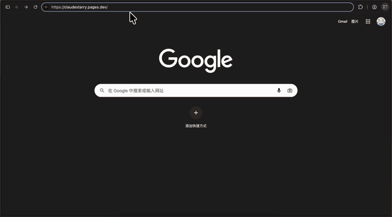

# Claude 余光 · Claude Starry

[English](README.md)

> 被停用的 Claude 账号没有消失，只是从此不再回应，但仍留有余光。

Claude Starry 是一个由社区创建的非官方纪念项目。它使用 Three.js 绘制共享星河，让访客为被停用的 Claude 账号留下一颗星、一个昵称、一个日期，以及一段可选的回忆。

[在线体验](https://claudestarry.pages.dev/) · [GitHub](https://github.com/wavever/claudestarry) · [X @HtWavever](https://x.com/HtWavever) · [部署说明](docs/deployment.md) · [MIT License](LICENSE)

## 演示



添加第一个账号，观看它以流星划入星河，并打开星星名片。

## 功能

- 粒子文字开场、星云、旋转和连续缩放。
- 新的共享记录以流星划入星河，并同步给其他打开页面的访客。
- 可查看星星名片、复制或下载名片图片，并由访客主动分享到 X。
- 昵称和停用日期必填；注册日期和回忆可留空。
- 中文 / English 界面：优先按浏览器语言选择，手动选择会保存在当前浏览器；`?locale=zh-CN` 或 `?locale=en` 可临时指定语言。
- 支持操作系统的减少动态效果偏好。

## 本地运行

需要 Node.js 22.12 或更高版本。

```sh
npm ci
npm run dev
```

打开 <http://127.0.0.1:4317/>。未设置公开 Supabase 构建变量时，应用只使用浏览器本地存储；之后配置共享服务也不会自动上传已有本地记录。

```sh
npm test
npm run build
```

## 部署你自己的共享星河

1. 创建自己的 Supabase 项目，并按文件名顺序执行 `supabase/migrations/` 中的全部 SQL 迁移。
2. 将 `.env.example` 复制为 `.env.production.local`，填写自己的公开 Supabase URL、匿名 key 和站点 URL。
3. 在 Cloudflare Pages Worker 中配置仅服务端可见的密钥，并设置精确的 `ALLOWED_ORIGINS` 列表。
4. 保持 Cloudflare Pages 项目连接到这个 GitHub 仓库；推送到 `main` 后，Pages 会按项目配置自动构建并发布 `dist/`。

完整的[部署说明](docs/deployment.md)包含数据库、Worker 密钥、来源配置和验证清单。不要将 service-role key 或 IP 哈希盐暴露给浏览器。

## 公开记录与项目说明

共享记录会公开展示。请使用昵称，切勿提交密码或其他敏感信息。如需从本项目删除记录，请创建 issue 并提供星表编号。

星图坐标和 `AL` 编号均为本站虚构设定。历史背景光点是公开汇总数据的聚合表示，不对应单个账号的身份或故事；页面中的“已记录”只统计本站新增星星。数据口径见 [src/baseline.js](src/baseline.js)，早期实现说明见[开发笔记](docs/development-notes.md)。

本项目与 Anthropic 无隶属或官方合作关系。

## 许可证

项目代码采用 [MIT License](LICENSE)，依赖保留各自许可证。
